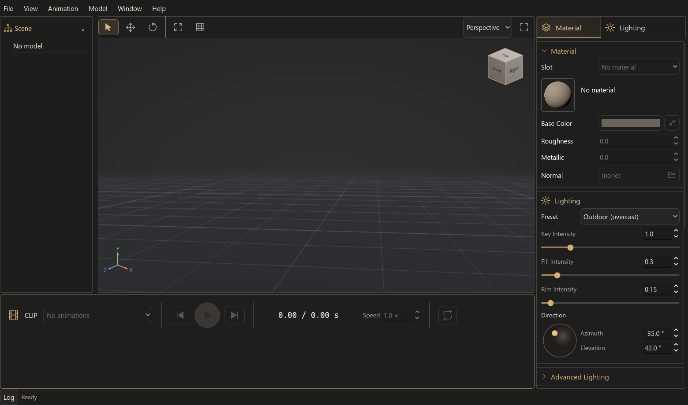
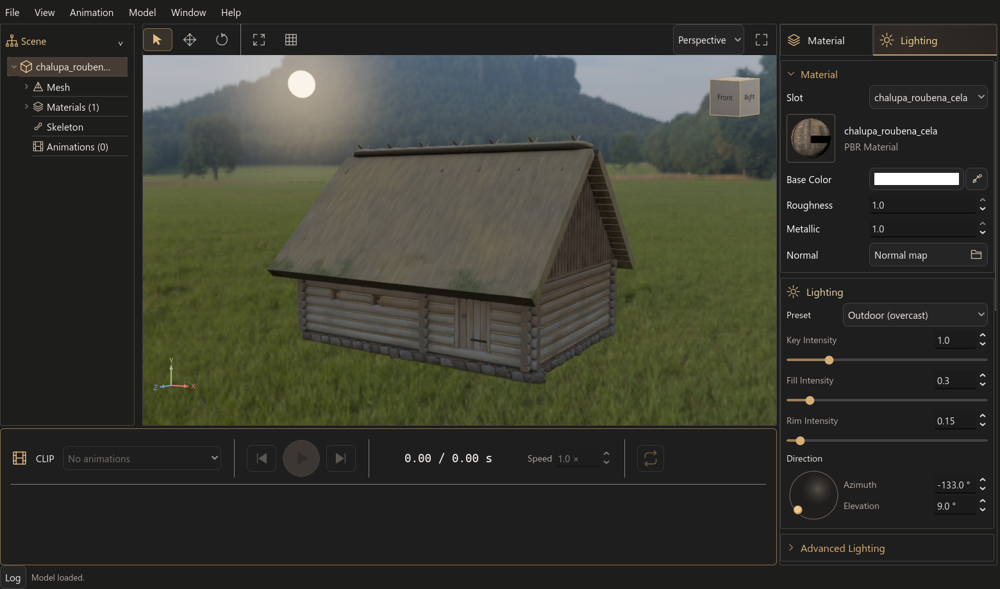
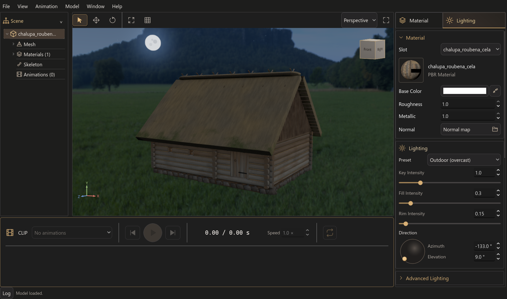
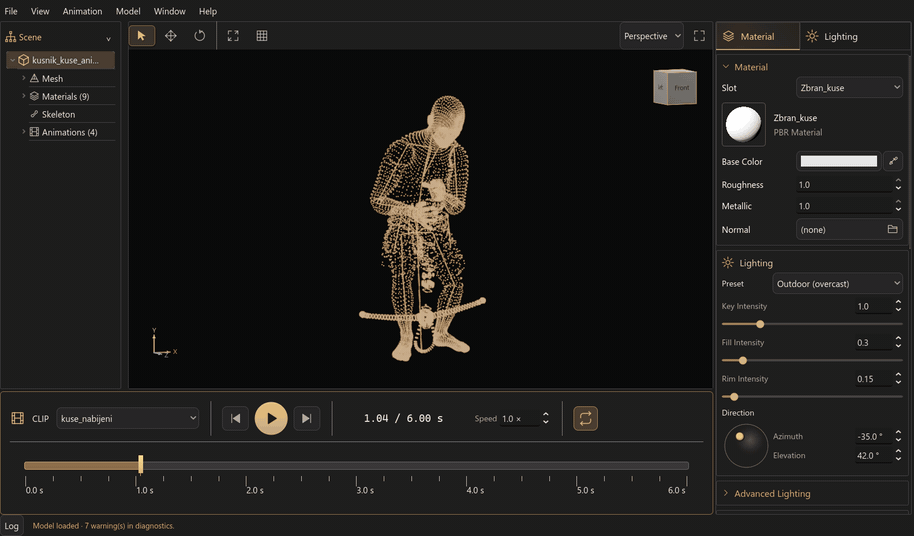
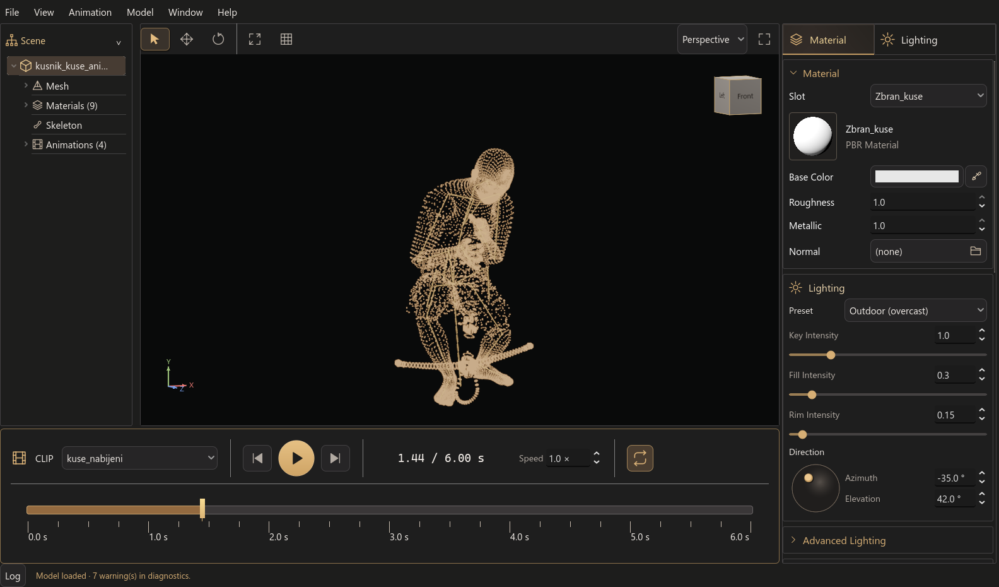
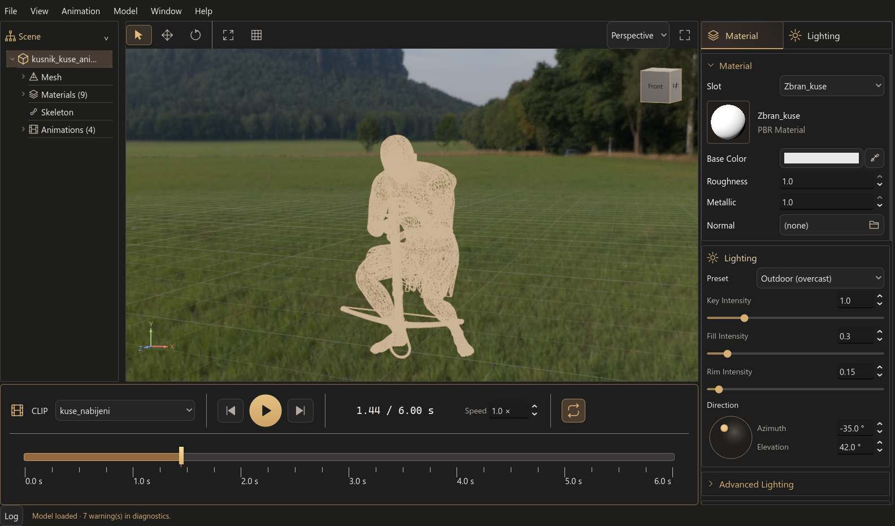
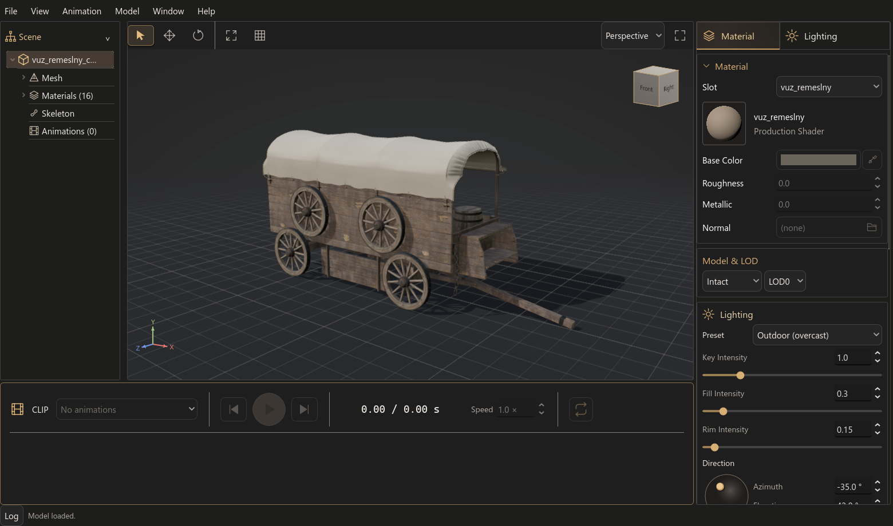
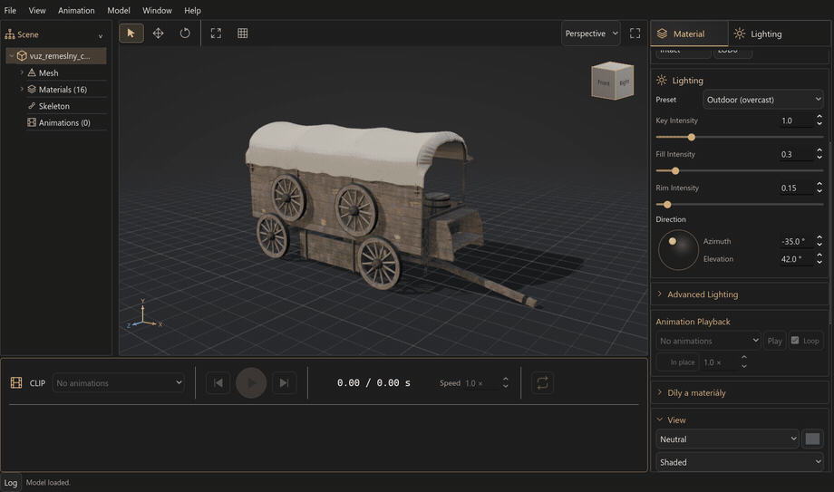

# WoB Model Viewer

[English guide](README.md) · [Podrobný tutoriál](docs/tutorial.cs.md) · [Wars of Bohemia](https://warsofbohemia.com/)

Offline desktopový prohlížeč GLB, glTF a FBX pro kontrolu geometrie, materiálů a animací. Podporuje původní shadery postav a sdílené atlasy Wars of Bohemia.



## Den a noc

| Den | Noc |
| --- | --- |
|  |  |

## Stažení a spuštění

V [nejnovějším vydání](https://github.com/RIGELIO/wob-model-viewer/releases/latest) najdeš instalační EXE pro **Windows x86-64** a balíček `.deb` pro **Debian a Ubuntu x86-64**. Balíček otevři ve správci balíčků nebo použij `sudo apt install ./wob-model-viewer_1.5.6_amd64.deb`. Vyber přenosný ZIP pro svůj systém. Po rozbalení spusť **WoB Model Viewer.exe** ve Windows nebo **wob-model-viewer** v Linuxu. Pokud linuxový rozbalovací nástroj odebral oprávnění ke spuštění, obnov je příkazem `chmod +x wob-model-viewer wob-gif`. Vše potřebné ke spuštění je v balíčku. Použij aktuální grafický ovladač.

Instalátor Windows a balíček DEB v Linuxu automaticky zaregistrují **.glb**, **.gltf**, **.fbx**, **.obj**, **.stl**, **.3mf** a **.wobview**. Pro otevírání dvojklikem zvol **WoB Model Viewer** ve výchozích aplikacích systému nebo přes **Otevřít v programu**. Instalátor Windows nastaví Viewer pro dosud neregistrované pohledy `.wobview` a na poslední stránce nabídne otevření nastavení výchozích aplikací. U přenosné verze spusť ve Windows **Register-FileTypes.cmd** nebo v Linuxu `sh register-file-types.sh`. Linuxový skript používá `shared-mime-info` a `desktop-file-utils`. Po přemístění přenosné aplikace registraci zopakuj.

Instalátor a EXE pro Windows jsou bez digitálního podpisu. Pokud Windows zobrazí výstrahu SmartScreen, ověř stažený soubor proti `SHA256SUMS.txt` na stránce vydání. Podpis umožní Windows zobrazit ověřeného vydavatele. SmartScreen při prvních staženích zohledňuje i reputaci nového souboru. [Dokumentace Microsoftu](https://learn.microsoft.com/windows/apps/package-and-deploy/smartscreen-reputation)

Instalátor před instalací zobrazí podmínky a licenci MIT. Při aktualizaci a odinstalaci vyzve k zavření otevřených oken prohlížeče. Odinstalátor odstraní program, jeho zástupce, registraci a známé soubory nastavení a mezipaměti. Uložené modely, relace a snímky zůstanou na svých místech.

Pro aktualizaci ve Windows stáhni a spusť novější instalátor. Rozpozná registrovanou instalaci, ukáže nalezenou verzi a aktualizuje stávající složku se zachováním nastavení. Spuštění stejné verze ji přeinstaluje do stejného umístění. V Linuxu aktualizuje stávající instalaci novější balíček DEB přes správce balíčků.

## První kroky

Od verze 1.5.2 zobrazí záložka **ⓘ** vedle osvětlení údaje o výběru ve stromu scény. **Ctrl+T** otevře terminál prohlížeče. Seznam příkazů vrátí `help`. [Tutoriál](docs/tutorial.cs.md) pokrývá terminál v aplikaci i dávkové úlohy.

V nabídce **Nápověda → Průvodce krok za krokem** je šest lekcí. Nabídky **Pohled**, **Animace** a **Model** zpřístupňují ovládání. Nastavení přehrávání, materiálů, osvětlení, zobrazení a editace najdeš vpravo v inspektoru. Vlevo je strom scény s viditelností sítí a výběrem materiálů, kostry a klipů. Časová osa dole obsahuje krok zpět, přehrávání, krok vpřed, rychlost a smyčku.

## Nástroje animace

Viewer 1.5 je zdarma a běží offline bez účtu a aktivace. Pro animovaný model s kostrou otevři **Model → Editor pohybu**. Můžeš vybírat klouby, krokovat po snímcích, zkoušet úpravy a kreslit značky vázané na kost. **Analyzovat pohyb** prověří kontakt chodidel, skoky rotace a návaznost smyčky. Kliknutím na nález přeskočíš na jeho čas. **Export reportu a úprav** výsledky uloží do JSONu.

Pro model bez kostry zvol **Model → Navrhnout novou kostru**. Začni lidskou nebo zvířecí šablonou nebo klikni na **Přidat kloub** a umísti ho do pohledu. Tažením upravíš polohu kloubu. Návrh `.wobrig` můžeš znovu otevřít a kostru vyexportovat do samostatného GLB.

Před volbou **Export animace GIF** nastav interval, FPS a rozlišení v nabídce **Model → Rozsah animace**. Přiložený kodér GIF ponech vedle přenosného programu.

## Manifesty vozů

Otevři `vuz_*_manifest.json` nebo jeden z GLB souborů z téže složky. Prohlížeč přiřadí produkční shader vozu, mapy albeda, normál a ORM a u dlaždicových modelů zachová význam `UV2` a `COLOR_0`. Stav vozu a úroveň detailů lze přepínat vpravo v části **Model a LOD**. `*_atlas.json` popisuje rozložení UV atlasu.

## Místní herní materiály

Ponech složku `_materialy-z-hry` se souborem `index.json` a adresářem `assets/` v kořeni kolekce hotových modelů. GLB chalupy, rekvizity, mostu nebo cesty otevři běžným způsobem. Viewer načte původní herní přiřazení materiálů z importu a prefabů, včetně odkazovaných map. Stejné rozložení složek funguje ve Windows i Linuxu. Chybějící podklady se zobrazí v panelu **Materiály a diagnostika**.

## Ovládání

1. Přetáhni `.glb` nebo `.gltf` do okna nebo jej otevři klávesami **Ctrl+O**. Během importu se zobrazí název souboru a animované kolečko. Soubory `.bin` a textury odkazované z `.gltf` ponech na jejich relativních cestách ve složce modelu. Jazyk přepneš v nabídce **Okno**, **F1** otevírá nápovědu a **F11** přepíná celou obrazovku.
2. **Levé tlačítko myši** otáčí pohledem. Pravé nebo prostřední tlačítko posouvá pohled a kolečko mění přiblížení. **F** zarámuje model. Kliknutím na stěnu orientační kostky nastavíš směr pohledu. Tažením za kostku pohled plynule otočíš. Přepínač posunu mění posun v rovině pohledu na posun po zemi.
3. V panelu **Osvětlení** vyber vestavěné panorama z Poly Haven nebo načti vlastní HDR či EXR v poměru 2 : 1. **Obloha HDRI** zobrazí původní panorama. Režimy **Den · Slunce** a **Noc · Měsíc** přidají viditelný zdroj přímého světla. Azimut a výška mění jeho polohu. Tlačítko **Ukázat zdroj** k němu otočí kameru. HDRI, přímé světlo a odrazy HDRI mají samostatné přepínače.
4. V panelu **Zobrazení** vyber barvu pozadí nebo panorama. Vypnutím pozadí získáš průhledné PNG. Mřížku, podlahu pro stíny, kostru a ortografický pohled můžeš zapínat samostatně. Vedle produkčních materiálů jsou k dispozici wireframe, režim bez osvětlení, normály, overdraw a **Body**. Velikost bodů mění průměr vykreslených vrcholů v režimu **Body**. **Geometrie** uvádí statistiky sítě a časová osa přehrává vložené klipy.
5. **Soubor → Uložit** nebo **Uložit jako** uloží odkaz na model, kameru, osvětlení, nastavení zobrazení a polohu animace do `.wobview`. Relaci znovu otevři přes **Soubor → Otevřít**. **Ctrl+E** nebo **Uložit 4K PNG** vykreslí aktuální 3D scénu do PNG o rozměrech 3840 × 2160.

Při průhledném pozadí se kůže zobrazuje bez podpovrchového rozptylu světla.

Viewer se spouští v maximalizovaném okně. Animace se po stisknutí **Přehrát** opakují. Zruš zaškrtnutí **Smyčka**, pokud chceš klip přehrát jednou.

Při výběru jiného klipu za běhu se nový klip hned přehrává. Když je animace pozastavená, zůstane pozastavený i nově vybraný klip.

Voličem u časové osy nastav rychlost **0× až 2×**. **Na místě** potlačí vodorovný posun u klipů s rozpoznaným kořenem pohybu a zachová výšku a pohyb končetin. Volba se hodí pro kontrolu chůze a běhu.

V časové ose zapni **Výřez**. V pravítku pod posuvníkem klikni na začátek a konec nebo úsek označ tažením. Můžeš také dvakrát použít **Animace → Označit čas přehrávací hlavou**. Výběr zapne smyčku a **Přehrát** opakuje jen vyznačený úsek. Vypni **Výřez** pro návrat k celému klipu. Výběr se ukládá do relace .wobview.

V **Osvětlení** zvol **Cyklus dne a noci**. Čas můžeš nastavit ručně nebo zapnout **Přehrávat cyklus**. **Délka cyklu** určuje, za kolik sekund uplyne celých 24 hodin. Čas a nastavení se ukládají do `.wobview`.

Indikátor se zobrazí také při přepínání panoramat a oblohy, přípravě bodů, quadů a náhledů atributů nebo exportu 4K snímku.

## Kontrola dílů a atributů

- **Ctrl+R** načte aktuální soubor znovu po exportu. Zachová kameru, světla, HDRI, stav vozu a vybraný LOD. Izolace zůstane zapnutá, pokud díl v novém exportu stále existuje.
- Rozbal **Díly a materiály** a vyber síť nebo jeden z jejích materiálových povrchů. Klikni na **Izolovat** nebo použij dvojklik. **Zobrazit vše** obnoví celý model. Statistika geometrie a LOD dál zahrnuje celý model na vybrané úrovni detailů.
- V **Zobrazení → Vertex barvy** vyber původní vrstvu, například `COLOR_0` nebo `COLOR_1`. Můžeš zobrazit RGB dohromady nebo jednotlivé kanály R, G, B a A ve stupních šedi. **UV0 · šachovnice** a **UV2 · šachovnice** zobrazí první a druhou UV vrstvu (`TEXCOORD_0` a `TEXCOORD_1` v glTF). Pruhy označí plochy, kde vybraný atribut chybí.

## Srovnání LOD

U modelu pojmenovaného například `postava_lod0.glb` prohlížeč vyhledá související soubory ve stejné složce, včetně variant jako `postava_lod1_helma.glb`. Seznam LOD ukazuje počty trojúhelníků a vrcholů ze zdrojové scény GLB a velikost každého souboru. Při přepnutí úrovně zůstane kamera na stejném místě.

**Wireframe** zobrazuje hrany trojúhelníků. V části **Zobrazení** se na stejném místě zobrazuje **Tloušťka čar** pro wireframe nebo **Velikost bodů** v režimu Body. Obě hodnoty se ukládají odděleně do relace. Režim **Quady (odhad)** odhaduje čtyřúhelníky spojením sousedních trojúhelníků a skrytím odhadnutých úhlopříček. Odhadované čtyřúhelníky se mohou od původní topologie lišit.

Barvu podlahy změníš vzorníkem u přepínače **Podlaha**. **Posun podlahy** pohybuje podlahou a mřížkou vůči výšce modelu v metrech, takže můžeš zkontrolovat třeba kontakt při pádu. Barva i posun se ukládají do relace `.wobview`.

V části **Zobrazení** zapni **Osy modelu** nebo stiskni **M**. Tažením šipky posuneš model po světové ose X, Y nebo Z. Tažením kruhu ho otočíš kolem příslušné osy. **Obnovit polohu** vrátí původní posun a natočení. Úpravy se ukládají do relace `.wobview`.

## Klávesové zkratky

| Klávesy | Akce |
| --- | --- |
| **1** nebo **F** · **2** · **3** · **4** | Zarámovat · Zepředu · Z boku · Shora |
| **W** · **Q** · **P** | Wireframe · Odhad čtyřúhelníků · Body |
| **G** · **K** · **A** · **B** · **O** | Mřížka · Kostra · Automatické otáčení · Zobrazení pozadí · Orto |
| **M** | Zapnout nebo vypnout osy modelu |
| **Page Up** · **Page Down** | Předchozí LOD · Další LOD |
| **Mezerník** | Přehrát nebo pozastavit animaci |
| **Ctrl+O** · **Ctrl+S** · **Ctrl+Shift+S** | Otevřít · Uložit relaci · Uložit relaci jako |
| **Ctrl+R** | Znovu načíst model a zachovat pohled |
| **Ctrl+E** · **Ctrl+Q** · **F1** | Exportovat 4K PNG · Ukončit · Nápověda |
| **F11** · **Esc** | Přepnout celou obrazovku · Návrat do okna |

## Produkční materiály a diagnostika

Prohlížeč podle názvu modelu a materiálu přiřazuje produkční shadery kůže, očí, oděvu, vlasových karet, mikrovláken vlasů a vousů a StubbleShell. Zdrojové soubory si zachovávají své původní vertex color vrstvy. Shader dostává vrstvu, kterou vyžaduje jeho materiál, včetně odlišných vstupů hustoty pro starší a 4K strniště.

Panel **Materiály a diagnostika** vypisuje chybějící atributy, textury i neznámé mapování shaderu. Kde je to možné, zůstává původní materiál z GLB. KeenFace hlavy bez materiálu a neprůhledná čepice LOD3 z referenční sady v5 se při chybějících produkčních podkladech zobrazí neutrálně a s upozorněním.

Kliknutím na žluté upozornění nebo na tlačítko **Protokol** ve spodní liště otevřeš historii aktuální relace. Protokol je dostupný také z **Nápověda → Protokol** nebo klávesami **Ctrl+L**. Tlačítkem **Zkopírovat protokol** přeneseš text do schránky.

Viewer hledá textury podle přesného názvu ve složce modelu a až dvě úrovně nad ní, včetně obvyklých složek `textury_4k`, `textury`, `textures` a `maps`. Pokud mapy nenajde, použij **Materiály a diagnostika → Načíst textury…**. Výběr začne o úroveň výš než model. Aplikace zachová kameru a složku uloží do relace.

U krátkých účesů V5 Viewer načte vlasové a vousové atlasy ze složky `textury_4k` a původní materiály obličeje z podkladového GLB ve stejném katalogu. Když GLB přesuneš jinam, zvol původní složku `textury_4k` ručně.

Vlastní mapování lze nastavit souborem `nazev-modelu.wob.json` ve stejné složce jako model. Klíče v `surfaces` spojují původní název uzlu a index primitivy od nuly. Příklad a názvy shaderů najdeš v [anglickém návodu](https://github.com/RIGELIO/wob-model-viewer#production-materials-and-diagnostics). Balíček obsahuje manifest původu a SHA-256 produkčních prostředků.

## Příkazová řádka

```sh
./wob-model-viewer -- "/local/postava.glb" "--language=cs"
./wob-model-viewer -- "/local/postava.glb" "--screenshot=/local/postava-4K.png"
```

Ve Windows stejné argumenty přijímá `"WoB Model Viewer.exe"`. Automatické snímání používá desktopový renderer a po uložení PNG aplikaci ukončí.

Tři vestavěná panoramata fungují offline. Licenční informace Godotu jsou součástí balíčku. [Lilienstein](https://polyhaven.com/a/lilienstein), [Kloppenheim 06 (Pure Sky)](https://polyhaven.com/a/kloppenheim_06_puresky), [Moonlit Golf](https://polyhaven.com/a/moonlit_golf) od Poly Haven, CC0.

## Licence

© 2026 RIGELIO Studio. Licence MIT umožňuje používání, úpravy a šíření se zachováním copyrightu a licenčního textu. Podrobnosti jsou v souborech [LICENSE](LICENSE) a [RESOURCE-LICENSES.md](RESOURCE-LICENSES.md). Verzi, copyright a licenci najdeš v aplikaci přes **Nápověda → O programu**.

## Galerie

### Animace kušníka

GIF ukazuje animaci v režimu Body se zapnutou kostrou. Wireframe zachycuje stejnou postavu s panoramatem Lilienstein a mřížkou.



| Body a kostra | Trojúhelníkový wireframe |
| --- | --- |
|  |  |

### Řemeslný vůz

Viewer načte produkční materiály z Wars of Bohemia a ukáže přepínač LOD. GIF střídá materiály, wireframe a šachovnici první UV vrstvy.





[UV šachovnice v plném rozlišení](screenshots/studio-wagon-uv.png)
