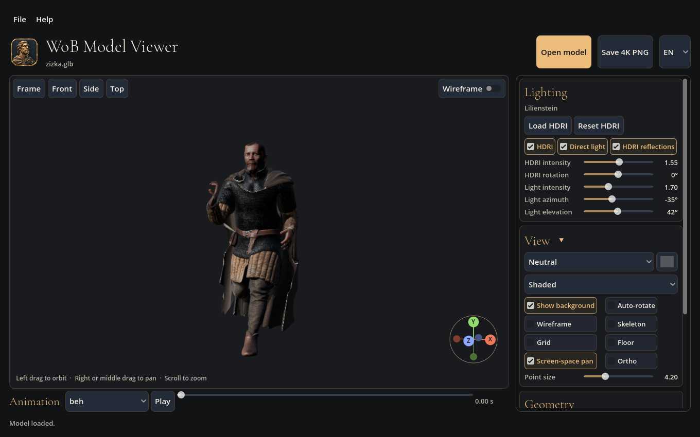
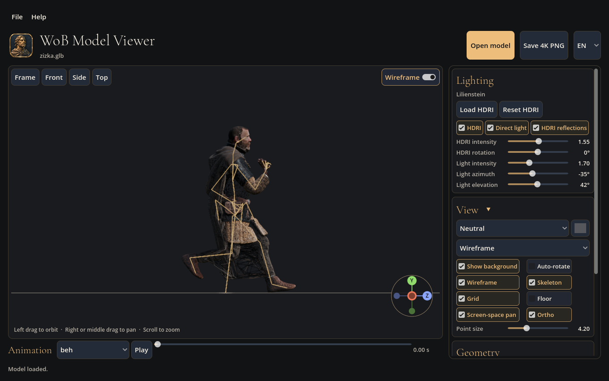
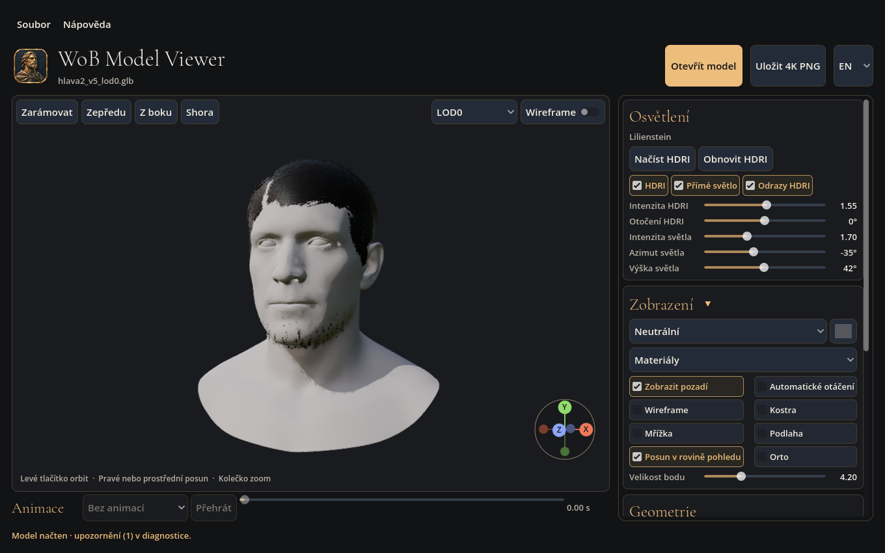

# WoB Model Viewer

[Download for Windows and Linux](https://github.com/RIGELIO/wob-model-viewer/releases/latest) · [Česky](README.cs.md) · [Build from source](BUILD.md)

WoB Model Viewer is an offline desktop viewer for GLB and glTF characters and materials from Wars of Bohemia. It runs on Godot 4.7.2 Forward+ and includes the game's character shaders and shared atlases.

## Download and run

Get the [latest release](https://github.com/RIGELIO/wob-model-viewer/releases/latest) for x86-64. On Windows, run the setup EXE to install for your user. On Debian and Ubuntu, install the `.deb` through the package manager or with `sudo apt install ./wob-model-viewer_1.0.0_amd64.deb`. Both platforms also have a portable ZIP. Extract it and run **WoB Model Viewer.exe** or **wob-model-viewer**. Use `chmod +x wob-model-viewer` if your Linux extractor removed the executable flag. A graphics driver with Godot Forward+ support is required.

To open GLB files by double-clicking in Windows, select **WoB Model Viewer** as the default for **.glb** in Windows Settings. The installer registers the app for your account. For the portable version, run **Register-GLB.cmd** first. Repeat registration if you move the portable executable.

## Inspect a model

1. Drop a `.glb` or `.gltf` anywhere in the window or press **Ctrl+O**. Keep any separate `.bin` and textures referenced by a `.gltf` at their relative paths within the model folder. Use **EN / CS** to switch the interface language and **F1** to open the controls reference.
2. Drag with the **left mouse button** to orbit. Drag with the right or middle button to pan and scroll to zoom. **F** frames the whole model. Use **Front**, **Side**, **Top** or the colored orientation axes to align the camera. Enable **Auto-rotate** to orbit continuously. The **Screen-space pan** toggle switches between view-aligned and ground-plane movement.
3. The **Lighting** panel switches ambient HDRI, direct light and HDRI reflections independently. Adjust HDRI gain and rotation or the direct light's intensity and direction. Load a 2:1 HDR or EXR panorama, or use the built-in Lilienstein HDRI.
4. **View** provides background colors and the HDRI panorama. Turn off **Show background** for transparent PNG exports. Toggle the grid, shadow-catching floor, skeleton overlay and orthographic projection independently. Inspect shaded, wireframe, unlit, normal-buffer, overdraw or **Points** views. **Point size** controls the size of vertex dots in **Points** mode. **Geometry** shows mesh statistics, and the timeline plays and scrubs embedded clips.
5. Use **File → Save** or **Save As** to save a `.wobview` file with the model reference, camera, lighting, display settings and animation position. Reopen it through **File → Open**. Use **Ctrl+E** or **Save 4K PNG** to render the current 3D view at 3840 × 2160.

Godot Forward+ disables subsurface scattering on skin when the background is transparent.

## Compare LODs

If a model is named like `character_lod0.glb`, the viewer finds matching files in the same folder, including variants such as `character_lod1_helma.glb`. The LOD list shows the triangle and vertex counts from the source GLB scene and the size of each file. Switch levels from the list to compare them while keeping the current camera.

**Wireframe** shows the GLB triangles. **Inferred quads** estimates quad boundaries by pairing adjacent triangles and hiding the inferred diagonals.

## Keyboard shortcuts

| Keys | Action |
| --- | --- |
| **1** or **F** · **2** · **3** · **4** | Frame · Front · Side · Top |
| **W** · **Q** · **P** | Wireframe · Inferred quads · Points |
| **G** · **K** · **A** · **B** · **O** | Grid · Skeleton · Auto-rotate · Show background · Ortho |
| **Page Up** · **Page Down** | Previous LOD · Next LOD |
| **Space** | Play or pause |
| **Ctrl+O** · **Ctrl+S** · **Ctrl+Shift+S** | Open · Save view · Save view as |
| **Ctrl+E** · **Ctrl+Q** · **F1** | Export 4K PNG · Quit · Help |

## Production materials and diagnostics

The viewer matches model and material names to the Wars of Bohemia shaders for skin, eyes, cloth, hair cards, hair and beard microfibers, and StubbleShell. Source files retain their original vertex color streams. Each production shader uses the stream required by that material, including the different density streams used by legacy and 4K StubbleShell.

Check **Materials & diagnostics** for unmatched shaders, missing attributes or missing textures. The viewer keeps the original GLB material where it can. Some material-free exports, including KeenFace heads and the opaque LOD3 hair cap in the v5 reference set, display with a neutral preview and a warning when there is no matching production material.

For custom mappings, create a `your-model.wob.json` beside the model. Keys in `surfaces` combine the glTF node name and zero-based primitive index. Local texture paths are relative to the model directory.

```json
{
  "surfaces": {
    "HeroMesh:0": {
      "shader": "kuze",
      "color": "COLOR_0",
      "textures": {
        "albedo_tex": "skin.png",
        "normal_tex": "skin-normal.png"
      }
    }
  }
}
```

Supported shader IDs are `kuze`, `oko`, `odev`, `vlasy_karty`, `vlasy_mikro_4k` and `vousy_strniste_shell`. The release includes the provenance and SHA-256 of its production resources.

## Command line

```sh
./wob-model-viewer -- "/local/character.glb" "--language=en"
./wob-model-viewer -- "/local/character.glb" "--screenshot=/local/character-4K.png"
```

Windows accepts the same arguments after `"WoB Model Viewer.exe"`. Automated screenshot capture uses the desktop renderer and exits after saving the PNG.

Built-in HDRI [Lilienstein by Poly Haven, CC0](https://polyhaven.com/a/lilienstein). Godot notices are bundled with each release.

## License

© 2026 RIGELIO Studio. The MIT license permits use, modification and redistribution with the copyright and license notice. See [LICENSE](LICENSE) and [resource licenses](RESOURCE-LICENSES.md). The application displays its version, copyright and license under **Help → About**.

## Screenshots

**English interface with production materials and lighting controls**



**Triangle wireframe, skeleton, and optional grid**



**LOD comparison and material diagnostics in Czech**



[Inferred quad view](screenshots/viewer-lod-quads.png) · [About WoB Model Viewer](screenshots/viewer-about.png)
